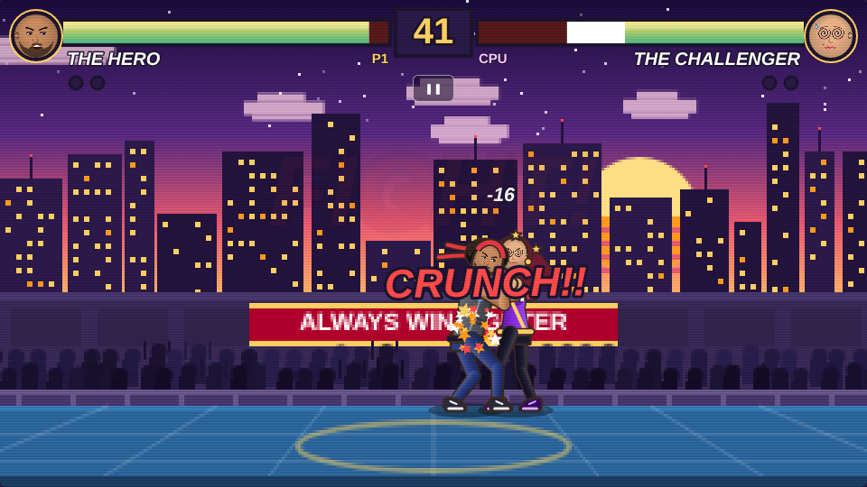

# Always Win Fighter

A browser-based 2D arcade fighting game, Street Fighter style, drawn entirely with the
HTML5 Canvas. Two fighters, one arena, best of three rounds. There is just one catch:
**the Hero always wins.** No matter what.



Plain HTML, CSS and JavaScript. No build step, no frameworks, no downloaded assets: every
sprite is drawn in code and every sound is synthesised with the Web Audio API.

## How to play

1. Open the game (see "Run it" below) and press **Start** (or Enter).
2. Watch the VS screen, then **ROUND 1... FIGHT!**
3. Punch the Challenger until she falls over, or do nothing and watch her fall over anyway.
4. Win two rounds to take the match, then hit **Play Again**.

### Controls

| Action | Keyboard | Touch |
| --- | --- | --- |
| Move | Arrow keys or `A` / `D` | ◀ ▶ |
| Jump | `↑` or `W` | ▲ JUMP |
| Block | `↓` or `S` (hold) | ▼ BLOCK (hold) |
| Jab (fast) | `J` | JAB |
| Power punch (short wind-up, big knockback) | `K` | POW |
| Pause | `P` or `Esc` | ❚❚ button under the timer |
| Start / confirm / play again | `Enter` or `Space` | tap |

The **Victory dance** button on the start screen (or adding `?dance` to the URL) shows the
Hero's victory dance without playing a match, with a picker to choose the routine he uses:
show-off, salsa, hip wiggle, arm swing, butt shake, shuffle with points, or chicken. The choice is
remembered in this browser. `?dance=chicken` opens the preview on a given routine.

On-screen touch buttons appear automatically on phones and tablets. They can be forced on or
off with the "Touch controls" button on the start screen. Rotate the phone sideways for a
bigger arena.

### The fighters

This copy uses **real photo figures**: full-body cut-outs in `assets/sprites/` listed in
`assets/sprites/sprites.js`. Each fighter has a standing pose plus 20 move poses (punches, kicks,
blocks, the hit reaction, crouches, the fallen pose, a jump and a victory pose); the Hero also has
20 victory-dance frames. Every move plays its real frame, with the whole figure lunging, leaning or
settling in between; a move without a frame falls back to the standing photo with paper-doll limbs.
The HUD portraits use `assets/faces/`. Remove `sprites.js` from `index.html` (or empty it) to go
back to the drawn fighters.

To add more real poses, generate images of the same person in the same outfit on a plain white
background, side view, and run them through the cut-out script (see "Adding sprite poses" below).


- **The Hero** (player 1): short tousled black hair, a trimmed beard, thick brows, a red headband,
  hand wraps and a charcoal jacket over a blue tee. Record 999 - 0.
- **The Challenger** (computer): long hair, fingerless gloves, trained for years, trips a lot.
  Record 0 - 999.

### How the fight is rigged

- The Challenger's attacks do 1 or 2 damage. The Hero's health **can never drop below 10%**.
  When she hits him at 10% the game shows **PLOT ARMOR!** and nothing happens.
- A jab does 7 damage, a power punch does 16, breaks her guard and often knocks her down.
- If you do nothing, every few seconds the Challenger **trips** (OOPS!), **gets tired**
  (TIRED!), **whiffs** a huge haymaker (WHIFF!) or **sneezes** (ACHOO!), and hurts herself.
  She knocks herself out before the 60 second timer runs out. If the timer does run out she
  collapses from exhaustion anyway.
- Every round ends with **HERO WINS!** and a victory dance. The default "Show-off" routine turns
  him all the way round: a spin, arms up facing the crowd with his hips swinging, a moonwalk
  slide, a back-view wiggle grinning over his shoulder and a jump into a split. A match is first
  to two rounds, which always means 2 - 0.

<!-- CUSTOM-FACES:START -->
## Birthday edition

Everything personal lives in `assets/birthday.js`: his name, the message typed out at the end, the
arena banner, the crowd's sign, the start-screen line, what the Challenger says when she trips,
tires, whiffs or sneezes, the sweet stats on the ending screen and an optional photo for the secret
screen (press **H** during the game). The last round win ends with "HAPPY BIRTHDAY" over his real
victory dance, hearts instead of confetti and the birthday song. Set `window.AWF_BIRTHDAY = null`
in that file to get the plain game back.

## Custom faces

Each fighter's head is an oval face area, so any face photo can be mapped onto it. The face follows the
head through every animation: walking, jumping, punching, getting knocked down and celebrating.

### Upload faces in the game

1. Press **Customize Fighters** on the start screen (or on the victory screen).
2. Press **Upload photo** under a fighter and pick an image from your device.
3. Use the **Zoom** slider and **drag the preview** to frame the face inside the circle.
4. Press **Fight!**

Photos never leave your device. They are cropped in the browser and kept only in this browser's
`localStorage` (downscaled to 512 px) so they are still there after a reload. **Use default**
removes a photo again. Default cartoon faces, with different expressions for normal, angry, hurt,
happy, dizzy and tired, are used whenever no photo is set.

### Ship faces with your copy of the game

To give everyone who visits your copy custom faces, put image files in `assets/faces/` and point
to them in `assets/faces/faces.js`:

```js
window.AWF_FACES = { hero: 'assets/faces/hero.png', challenger: 'assets/faces/challenger.png' };
```

A photo uploaded by a player always takes priority over these files.
<!-- CUSTOM-FACES:END -->

## Adding sprite poses

`assets/sprites/sprites.js` describes each frame: the image, its size, the anchor (`ax`, `ay`:
the horizontal centre of the feet and the bottom of the feet) and `ref`, the standing height of
the grid it was cut from, so all frames of one grid share a scale. The `act` poses are keyed
`stand2`, `jab`, `punchfront`, `cross`, `uppercut`, `overhead`, `lunge`, `crouchguard`, `squat`,
`leanback`, `kneeup`, `sidekick`, `highkick`, `knee`, `fallen`, `palm`, `jump`, `floor`, `palms`
and `fistup`; the game maps its states onto them (a jab uses `jab`, the power punch winds up with
`cross` and lands with `uppercut`, a kick chambers with `knee` and lands with `sidekick`, hits use
`leanback`, blocks `palms`, knockdowns `fallen`, and so on). Generate the poses on a plain white
background as a 5 x 4 grid in that order, cut them out, and add the entries. `faceDir` is the
direction the figure faces in its images (1 = right, -1 = left).

## Run it

The game is static. Either open `index.html` directly in a browser, or serve the folder:

```bash
python3 -m http.server 8000
```

then visit `http://localhost:8000/`.

## Host it on GitHub Pages

### As its own repository

```bash
git init
git add .
git commit -m "Always Win Fighter"
gh repo create always-win-fighter --public --source=. --remote=origin --push
gh api -X POST "repos/{owner}/always-win-fighter/pages" -f "source[branch]=main" -f "source[path]=/"
```

The site appears a minute later at `https://<your-user>.github.io/always-win-fighter/`.
You can also enable it by hand: repository **Settings** → **Pages** → **Source: Deploy from a
branch** → branch `main`, folder `/ (root)`.

### As a folder inside another site

Copy the `always-win-fighter/` folder into the site and it works at
`https://<site>/always-win-fighter/`. All paths in the game are relative.

## Project structure

| File | What it is |
| --- | --- |
| `index.html` | The page: canvas, overlay screens (start, customize, pause, victory) and touch buttons |
| `style.css` | Layout of the 16:9 stage, arcade-style buttons, touch controls, phone layouts |
| `game.js` | The whole game: sound, input, faces, animation, fighters, AI, arena, HUD, game loop |
| `assets/favicon.svg` | Browser tab icon |
| `assets/faces/faces.js` | Face photos used for the HUD portraits (see "Custom faces") |
| `assets/sprites/` | Full-body photo figures and their manifest `sprites.js` |
| `assets/screenshot.png` | The screenshot above |

## How it works (for the curious)

- **Game loop**: `requestAnimationFrame` at the display rate (normally 60 FPS) with a clamped
  delta time, a short "hit stop" freeze on impact and slow motion on the K.O.
- **Fighters** are small skeletons drawn as tapered limbs with gradient shading and rounded
  joints, fists, shoes, a shaped torso (shoulders, waist, hips), egg-shaped heads and hair, with
  thin outlines in a darker tone of each colour. A *pose* stores the hip height, body
  rotation, torso lean, arm angles and foot positions; knees are solved with two-bone inverse
  kinematics. Joints are
  3D (arms and legs have sideways positions), so a pose can also turn the body with a `yaw`:
  parts are projected and drawn far to near, the torso is a projected box, and the face slides
  around the head as he turns. The fights stay in side view; the dances use the turning. Animation
  *clips* are either keyframe lists or small procedural functions (walk cycle, idle breathing,
  victory hops) and the game blends smoothly between them when the state changes.
- **Hit detection** is a circle at the punching fist (or kicking foot) during the attack's
  active frames against an axis-aligned hurtbox around the opponent. Fighters are invulnerable
  while lying on the floor.
- **Effects**: screen shake, white flash, star-shaped hit sparks, dust, sweat, confetti and
  comic-book pop-ups (POW!, KAPOW!!, OOPS!, ACHOO!).
- **Arena**: drawn once at one third resolution and scaled up with image smoothing off, which
  gives the pixel-art look. Clouds drift and the crowd bobs.
- **Audio**: punches, blocks, whooshes, the K.O. sting, the round fanfare and the slide-whistle
  trip are all oscillators and filtered noise from the Web Audio API, created after the first
  key press or tap (browsers require a user gesture).
- **Debugging**: the running game is exposed as `window.AWF` in the browser console, for example
  `AWF.hero.hp`, `AWF.challenger.state` or `AWF.debugSpeed = 4` to fast-forward.

Everything here is original work drawn in code; there are no copyrighted characters or assets.
